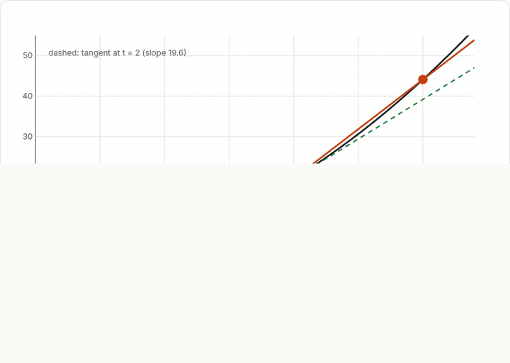
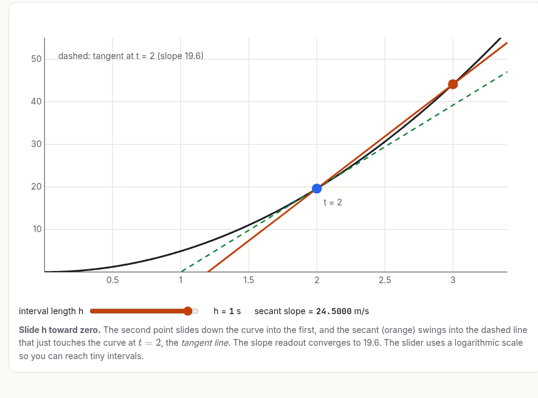
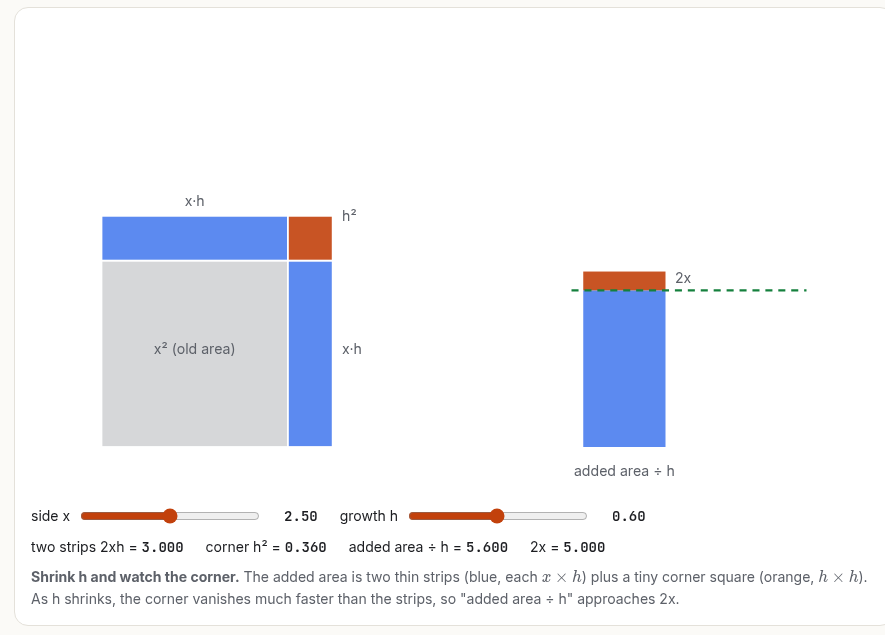
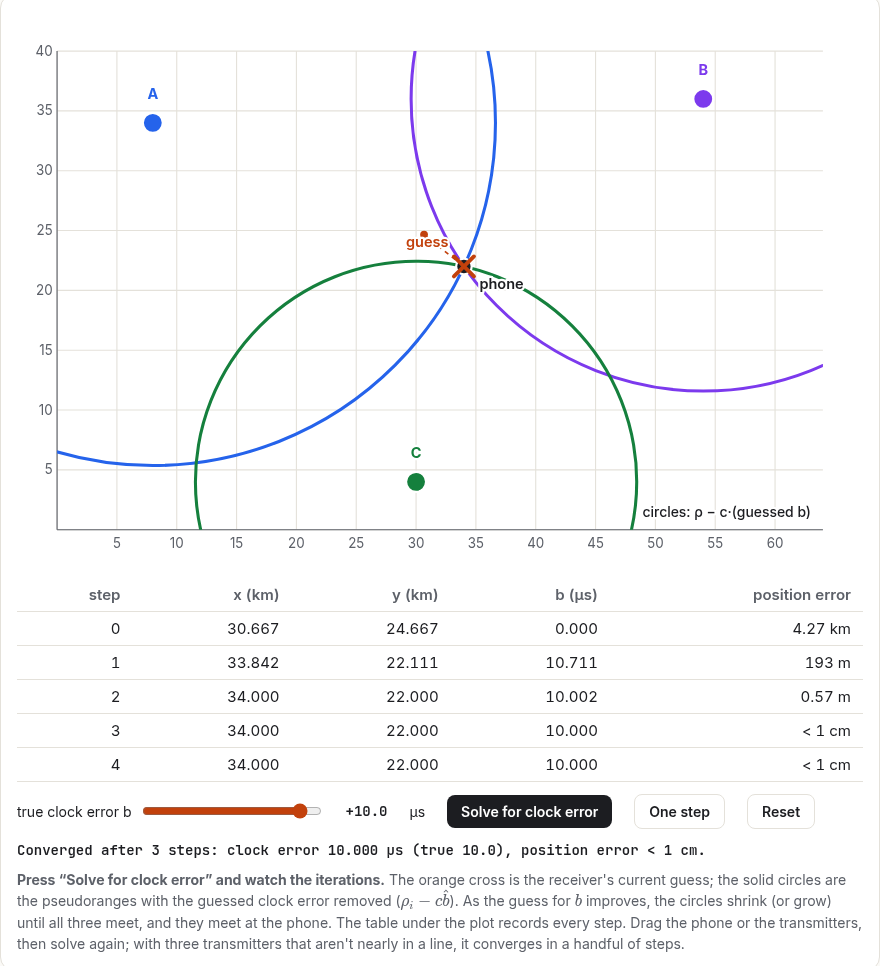
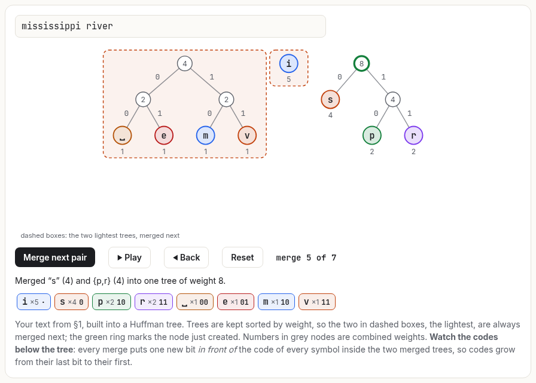

<p align="center">
  
</p>

<p align="center">
  <a href="LICENSE"></a>
  <a href="https://docs.claude.com/en/docs/claude-code/skills"></a>
  
  <a href="https://github.com/mahdi13830510/eureka/stargazers"></a>
</p>

<p align="center"><b>Stop getting summaries. Start getting lessons.</b><br>
<code>eureka</code> turns Claude into a professor who builds hard ideas from the ground up, with StatQuest-level step-by-step depth and 3Blue1Brown-style visual intuition, and delivers them as interactive lessons, textbook PDFs, lecture slides or notebooks.</p>

<p align="center">
  <a href="https://mahdi13830510.github.io/eureka/showcase/derivatives/"></a>
  <br><sub>A real eureka lesson: shrink h and the secant becomes the tangent, while the slope readout converges to 19.6 m/s.</sub>
  <br><a href="https://mahdi13830510.github.io/eureka/showcase/derivatives/"><b>▶ Try it yourself: The Derivative, a live interactive lesson</b></a>
</p>

---

## The difference, in one question

> **"What is a derivative?"**

**A typical AI answer:**
> *The derivative of a function measures the rate at which the function's output changes with respect to its input. It is defined as f′(x) = lim<sub>h→0</sub> (f(x+h) − f(x))/h and represents the slope of the tangent line.*

Every word is true, and you've learned nothing.

**With `eureka`**, Claude starts from the *problem*: a falling stone has a speed at every instant, yet "distance ÷ time" over an instant is 0/0. Then it builds each idea you need:
- average rate of change, as the slope of a secant you can drag;
- shrinking the interval, as a live table that closes in on 19.6 m/s;
- the algebra that makes the pattern certain, revealed one step at a time;
- limits, as an ε–δ game;
- the derivative itself;
- "zoom in until the curve is straight";
- x² as a growing square, whose corner vanishes;
- the power rule;
- where it all breaks, including why `h = 1e-15` gives garbage on a real computer.

You get to play with each idea:

<p align="center">
  
  
  <br><sub>From the <a href="https://mahdi13830510.github.io/eureka/showcase/derivatives/">derivatives lesson</a>. Left: shrink h, and the secant becomes the tangent. Right: d(x²)/dx = 2x, seen as the strips of a growing square.</sub>
</p>

## Lessons you can open right now

Each one was built with eureka, verified in a headless browser, and covers a different field.

<table>
<tr>
<td width="33%" valign="top"><a href="https://mahdi13830510.github.io/eureka/showcase/derivatives/"></a><br><b><a href="https://mahdi13830510.github.io/eureka/showcase/derivatives/">The Derivative</a></b><br><sub>Calculus. How can a stone have a speed at an instant? Secants, limits, and x² as a growing square.</sub></td>
<td width="33%" valign="top"><a href="https://mahdi13830510.github.io/eureka/showcase/gps/"></a><br><b><a href="https://mahdi13830510.github.io/eureka/showcase/gps/">How GPS Knows Where You Are</a></b><br><sub>Physics. Time of flight, trilateration, solving for your phone's clock error, and why relativity matters.</sub></td>
<td width="33%" valign="top"><a href="https://mahdi13830510.github.io/eureka/showcase/compression/"></a><br><b><a href="https://mahdi13830510.github.io/eureka/showcase/compression/">How ZIP Makes Files Smaller</a></b><br><sub>Computer science. Prefix codes, building a Huffman tree from your own text, entropy, and DEFLATE.</sub></td>
</tr>
</table>

## What it does

- **Problem first.** Every lesson starts by making the *problem* understandable: what we want, why the obvious approach fails, what a solution must satisfy. The concept then arrives as the answer.
- **Component by component.** It maps every idea the topic depends on and teaches each one individually (problem → picture → mechanism → definition → derivation → example) before combining them. Nothing is name-dropped.
- **Every equation earned.** Each symbol is defined with its shape and units. The lesson says why the formula has *this* form and derives every step with its justification. No "after some algebra".
- **Your format, made exceptional.** It asks how you want to learn and builds that:

  | Format | What you get |
  |---|---|
  | 🌐 **Interactive HTML** | a course-quality page: live widgets, step-by-step derivations, KaTeX math, light and dark themes, works on phones |
  | 📄 **PDF** | a typeset textbook chapter: numbered definitions, full derivations, figures, exercises |
  | 🎞️ **Slides** | a complete lecture, one idea per slide, with progressive build-ups |
  | 📓 **Jupyter notebook** | a computational lab: explanations, derivations, runnable experiments |
  | 🧪 **Simulation** | a standalone tool to explore one concept deeply |
  | 🎬 **Animation** | Manim or matplotlib animations of transformations unfolding |
  | 💬 **Chat** | the full lesson inline, with figures |

- **Verified, not just generated.** HTML lessons are loaded in a headless browser before you see them. It checks for JavaScript errors, broken math and widgets that don't respond, and looks at screenshots. PDFs and slides are rendered and inspected; notebooks are executed. Nothing is ever described as rendered when it wasn't.
- **Honest.** No invented statistics, anecdotes or citations. In paper mode it separates theorem, experiment, author claim, and its own interpretation.
- **Depth over breadth.** Big topics are split into complete parts with a roadmap instead of being compressed.

## Install

### Claude Code

As a plugin (gets updates through `/plugin`):

```
/plugin marketplace add mahdi13830510/eureka
/plugin install eureka@eureka
```

Or as a plain skill, in one line:

```bash
git clone https://github.com/mahdi13830510/eureka ~/.claude/skills/eureka
```

Start a new session and ask to learn something, or call it directly:

```
/eureka teach me eigenvectors as an interactive lesson
```

For a whole team, clone it into `<project>/.claude/skills/eureka/` and commit it.

### Claude.ai (web, desktop, mobile)

1. Download `eureka.zip` from the [latest release](https://github.com/mahdi13830510/eureka/releases/latest).
2. **Settings → Capabilities**: turn on *Code execution and file creation*.
3. **Settings → Capabilities → Skills → Upload skill**, and choose the zip.

### Claude API / Agent SDK

Upload the folder through the Skills API, or place it in `.claude/skills/` for the Agent SDK. The format is the standard [Agent Skills](https://docs.claude.com/en/docs/agents-and-tools/agent-skills/overview) layout.

**Optional tools** make richer formats possible: Chromium/Chrome (verifying HTML lessons), Typst or LaTeX/tectonic (PDF), Manim and ffmpeg (animations), Jupyter (notebooks). The skill checks what you have and adapts.

## Modes

These are chosen automatically from how you ask; you can also name one.

| Mode | Say something like | You get |
|---|---|---|
| **Deep** (default) | "teach me…", "help me understand…" | the full component-by-component lesson, in parts if needed |
| **Intuitive** | "give me the intuition", "no math" | problem, mental model, visuals |
| **Mathematical** | "derive", "prove", "formally" | definitions, assumptions, complete derivations |
| **Research** | an arXiv link or paper | prerequisites taught fully, then method, theory, experiments, critique |
| **Implementation** | "implement from scratch" | theory → hand example → code that mirrors the math |
| **Notebook** | "notes for my notebook" | dense, precise notes |
| **Exam** | "practice problems", "test me" | must-know derivations, tiered problems, classic mistakes |
| **Quick** | short factual questions | a direct answer in a few sentences |

## Sample lessons

| Lesson | Format | Opens with |
|---|---|---|
| [**The Derivative**](https://mahdi13830510.github.io/eureka/showcase/derivatives/) ([source](showcase/derivatives/)) | interactive HTML | how can a stone have a speed at an instant, when distance ÷ time is 0/0? |
| [**How GPS Knows Where You Are**](https://mahdi13830510.github.io/eureka/showcase/gps/) ([source](showcase/gps/)) | interactive HTML | a phone hears "I'm here, and it's exactly this time", and nothing else |
| [**How ZIP Makes Files Smaller**](https://mahdi13830510.github.io/eureka/showcase/compression/) ([source](showcase/compression/)) | interactive HTML | why spend 8 bits on every letter, whether it's 'e' or 'z'? |
| [Eigenvectors](tests/sessions/eigenvectors.md) | chat | a bike-share fleet settling into a 600/400 split |
| [Bayesian probability](tests/sessions/bayesian-probability.md) | chat | a flaky CI test: did my commit break it? |
| [Gradient descent](tests/sessions/gradient-descent.md) | chat | camera autofocus, then an exact step-size ceiling from curvature |
| [Backpropagation](tests/sessions/backpropagation.md) | chat | the cost of nudging 79,510 weights one at a time |
| [KL divergence](tests/sessions/round2-kl-divergence.md) | chat | grading a forecaster you can only sample |
| [RSA](tests/sessions/round2-rsa.md) | chat | talking securely to a bank over café Wi-Fi |
| [TCP congestion control](tests/sessions/tcp-congestion-control.md) | chat | an unknown bottleneck and the 1986 congestion collapse |
| [A research paper: FedMuon](showcase/fedmuon-part1.md) | chat + figures | why averaging normalized updates finds a median, not the optimum |

The chat lessons were written by fresh Claude instances that had only this skill, and were scored against a 13-criterion [rubric](tests/rubric.md).

## How it's built

```
eureka/
├── SKILL.md                     core method: problem → format → component map → teach each → assemble → verify
├── references/                  loaded only when needed (progressive disclosure)
│   ├── formats.md               HTML / PDF / slides / notebook / simulation / animation: standards and QA
│   ├── voice.md                 sounding like a teacher; anti-compression rules
│   ├── visuals.md               choosing, generating and verifying plots, animations, diagrams
│   ├── math-teaching.md         component protocol, equation protocol, worked component chains
│   ├── philosophy.md            lesson design; what the best explainers do
│   ├── examples-guide.md        mechanism-matched examples and a fact-checked example bank
│   ├── technical-subjects.md    algorithms, systems, networks, databases, ML, physics, stats
│   ├── research-papers.md       teaching (not summarizing) a paper
│   ├── implementation.md        theory → code that mirrors the math
│   ├── assessment.md            checks, mistake repair, retrieval and spacing
│   └── modes.md                 output shape for every mode
├── templates/html-lesson/       design system + runtime (TOC, KaTeX, step-by-step derivations, SVG plotting, self-tests)
├── scripts/check_html.py        headless-browser verification: JS errors, math, widget self-tests, overflow, screenshots
├── examples/                    style-calibration sessions
├── showcase/                    finished lessons
└── tests/                       rubric, generated lessons, evaluation report
```

The skill went through several rounds of testing with fresh Claude instances, and was revised each round from their output and their critiques of the instructions. The full record is in [`tests/evaluation.md`](tests/evaluation.md).

## Contributing

Lessons that fall short are the most useful contribution. If `eureka` compresses, skips a step, picks a bad example, or ships a broken widget, [open an issue](https://github.com/mahdi13830510/eureka/issues) with the prompt and the part that went wrong. See [CONTRIBUTING.md](CONTRIBUTING.md).

If it helped you finally understand something, a ⭐ helps other people find it.

## License

[MIT](LICENSE). Inspired by the teaching of 3Blue1Brown, StatQuest, Welch Labs, Reducible and Computerphile; not affiliated with any of them.
