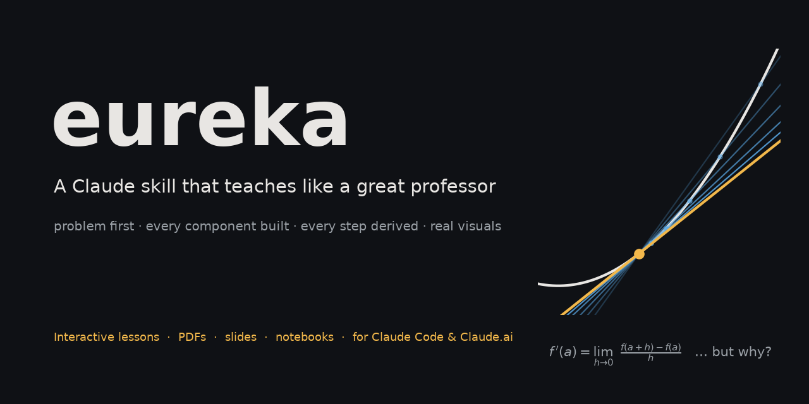
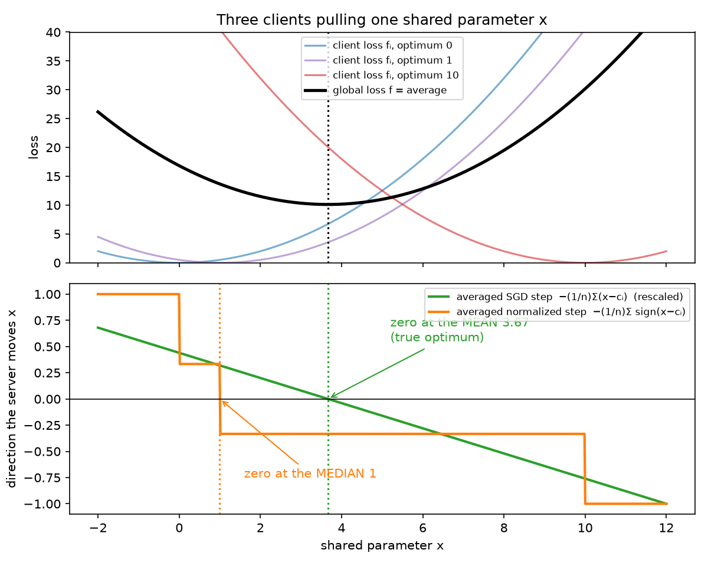
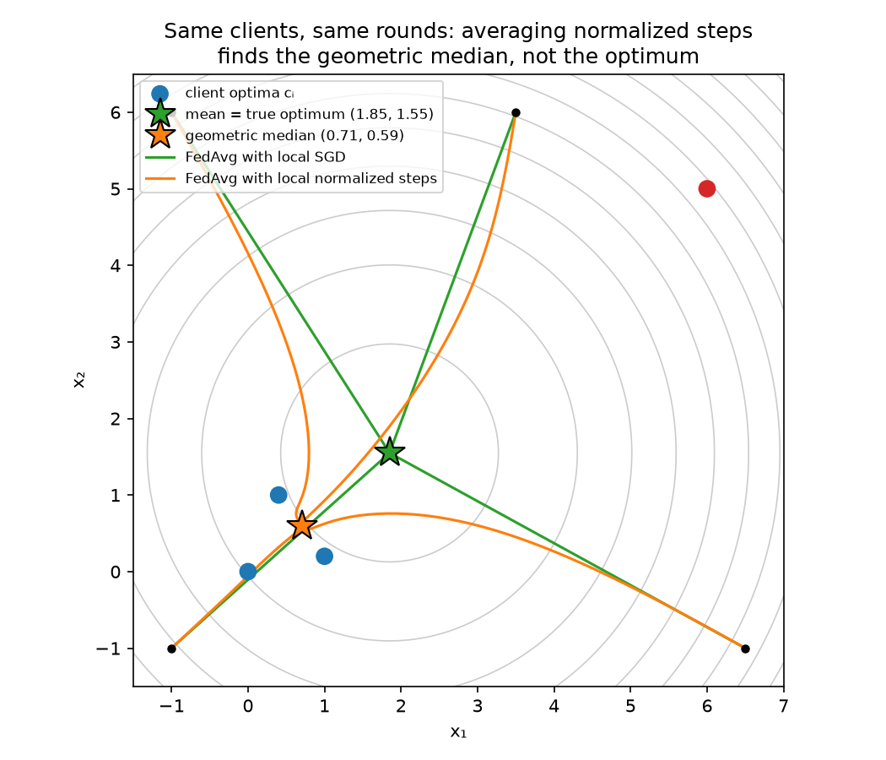

<p align="center">
  
</p>

<p align="center">
  <a href="LICENSE"></a>
  <a href="https://docs.claude.com/en/docs/claude-code/skills"></a>
  
  <a href="https://github.com/mahdi13830510/eureka/stargazers"></a>
</p>

<p align="center"><b>Stop getting summaries. Start getting lessons.</b><br>
<code>eureka</code> turns Claude into a professor who builds hard ideas from the ground up, with StatQuest-level step-by-step depth and 3Blue1Brown-style geometric intuition.</p>

---

## The difference, in one question

> **"Teach me the Muon optimizer. Why does it orthogonalize the update?"**

**A typical AI answer:**
> *Muon is an optimizer that orthogonalizes the momentum update using Newton–Schulz iterations, which approximates UVᵀ from the SVD. This improves conditioning and leads to faster training…*

Every word is true, and you've learned nothing.

**With `eureka`**, Claude first maps the chain of ideas you need: weight matrix as a linear map → why gradients are sums of outer products → SVD as rotate–stretch–rotate → orthogonal matrices and the polar factor → why Gram–Schmidt gives a *different* answer → the spectral norm → steepest descent under a norm. Then it teaches each one, with derivations, worked numbers, and figures it renders and checks itself, before it lets them combine into Muon:

<p align="center">
  
  <br><sub>Generated during a lesson: the same rotations with and without the stretch. That is what "orthogonalizing" means.</sub>
</p>

## What it does

- **Problem first.** Every lesson starts by making the *problem* understandable: what we want, why the obvious approach fails, what a solution must satisfy. The concept then arrives as the answer, so it feels like something you could have invented.
- **Component by component.** Before writing, it maps every idea the topic depends on and teaches each one individually (problem → picture → mechanism → definition → derivation → example) before combining them. Nothing is name-dropped.
- **Every equation earned.** Each symbol is defined with its shape and units. The lesson says why the formula has *this* form and derives every step with its justification. No "after some algebra".
- **Real visuals, not ASCII.** It writes and runs matplotlib plots, Manim animations, and Graphviz, Mermaid or Excalidraw diagrams, then looks at the output before referring to it. It never claims a figure exists when it doesn't.
- **Honest.** No invented statistics, anecdotes or citations. Uncertain facts get checked. In paper mode it separates theorem, experiment, author claim, and its own interpretation.
- **Depth over breadth.** Big topics are split into complete parts with a roadmap instead of being compressed into a summary.
- **Sounds like a person at a whiteboard**, not an encyclopedia: connected reasoning, guiding questions, no bullet soup, no "let's dive in".

## Gallery: from a real lesson on FedMuon

The prompt was *"explain me fedmuon"*. The skill found that two 2025 papers share the name, read both, and built Part 1 around a phenomenon it demonstrated by running simulations: **averaging normalized client updates turns a weighted average into a vote**.

<p align="center">
  
  
</p>

📖 **[Read the full lesson →](showcase/fedmuon-part1.md)**

## Install

### Claude Code (one line)

```bash
git clone https://github.com/mahdi13830510/eureka ~/.claude/skills/eureka
```

Start a new session and just ask to learn something ("teach me Kalman filters"), or call it directly:

```
/eureka why does the transformer need positional encodings?
```

For a whole team, clone it into `<project>/.claude/skills/eureka/` and commit it.

### Claude.ai (web, desktop, mobile)

1. Download `eureka.zip` from the [latest release](https://github.com/mahdi13830510/eureka/releases/latest).
2. **Settings → Capabilities**: turn on *Code execution and file creation*.
3. **Settings → Capabilities → Skills → Upload skill**, and choose the zip.

### Claude API / Agent SDK

Upload the folder through the Skills API, or place it in `.claude/skills/` for the Agent SDK. The format is the standard [Agent Skills](https://docs.claude.com/en/docs/agents-and-tools/agent-skills/overview) layout.

## Modes

These are chosen automatically from how you ask; you can also name one.

| Mode | Say something like | You get |
|---|---|---|
| **Deep** (default) | "teach me…", "help me understand…" | the full component-by-component lesson, in parts if needed |
| **Intuitive** | "give me the intuition", "no math" | problem, mental model, visuals |
| **Mathematical** | "derive", "prove", "formally" | definitions, assumptions, complete derivations |
| **Research** | an arXiv link or paper | prerequisites taught fully, then method, theory, experiments, critique |
| **Implementation** | "implement from scratch" | theory → hand example → code that mirrors the math |
| **Notebook** | "notes for my notebook" | dense, precise notes |
| **Exam** | "practice problems", "test me" | must-know derivations, tiered problems, classic mistakes |
| **Quick** | short factual questions | a direct answer in a few sentences |

## Sample lessons

All of these were written by fresh Claude instances that had only this skill (no extra prompting), and were then scored against a 13-criterion [rubric](tests/rubric.md).

| Topic | Opens with |
|---|---|
| [FedMuon, Part 1](showcase/fedmuon-part1.md) | why FedAvg + normalized optimizers converge to a median instead of the optimum |
| [Muon optimizer, Part 1](tests/sessions/round3-muon.md) | a weight matrix is a linear map, not a bag of numbers |
| [Backpropagation](tests/sessions/backpropagation.md) | the cost of nudging 79,510 weights one at a time |
| [Eigenvectors](tests/sessions/eigenvectors.md) | a bike-share fleet settling into a 600/400 split |
| [Gradient descent](tests/sessions/gradient-descent.md) | camera autofocus, then an exact step-size ceiling from curvature |
| [Bayesian probability](tests/sessions/bayesian-probability.md) | a flaky CI test: did my commit break it? |
| [TCP congestion control](tests/sessions/tcp-congestion-control.md) | an unknown bottleneck and the 1986 congestion collapse |
| [KL divergence](tests/sessions/round2-kl-divergence.md) | grading a forecaster you can only sample |
| [RSA](tests/sessions/round2-rsa.md) | talking securely to a bank over café Wi-Fi |

## How it's built

```
eureka/
├── SKILL.md                     core method: problem → component map → teach each → assemble → mastery test
├── references/                  loaded only when needed (progressive disclosure)
│   ├── voice.md                 sounding like a teacher; anti-compression rules
│   ├── visuals.md               choosing, generating and verifying plots, animations, diagrams
│   ├── math-teaching.md         component protocol, equation protocol, worked component chains
│   ├── philosophy.md            lesson design; what the best explainers do
│   ├── examples-guide.md        mechanism-matched examples and a fact-checked example bank
│   ├── technical-subjects.md    algorithms, systems, networks, databases, ML, physics, stats
│   ├── research-papers.md       teaching (not summarizing) a paper
│   ├── implementation.md        theory → code that mirrors the math
│   ├── assessment.md            checks, mistake repair, retrieval and spacing
│   └── modes.md                 output shape for every mode
├── examples/                    style-calibration sessions
├── showcase/                    a full lesson with its generated figures
└── tests/                       rubric, generated lessons, evaluation report
```

The skill went through three rounds of testing with fresh Claude instances, and was revised each round from their output and their critiques of the instructions. The full record is in [`tests/evaluation.md`](tests/evaluation.md).

## Contributing

Lessons that fall short are the most useful contribution. If `eureka` compresses, skips a step, or picks a bad example, [open an issue](https://github.com/mahdi13830510/eureka/issues) with the prompt and the part that went wrong. See [CONTRIBUTING.md](CONTRIBUTING.md).

If it helped you finally understand something, a ⭐ helps other people find it.

## License

[MIT](LICENSE). Inspired by the teaching of 3Blue1Brown, StatQuest, Welch Labs, Reducible and Computerphile; not affiliated with any of them.
