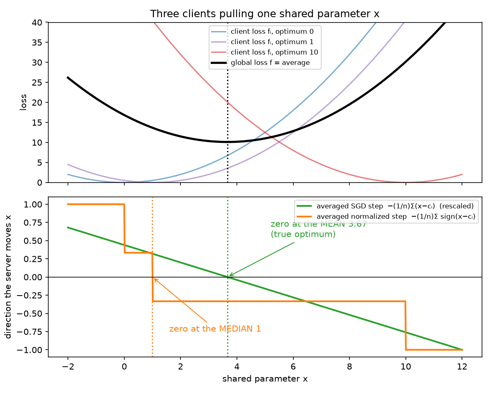
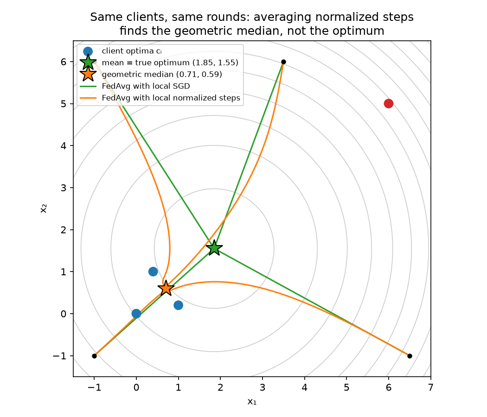
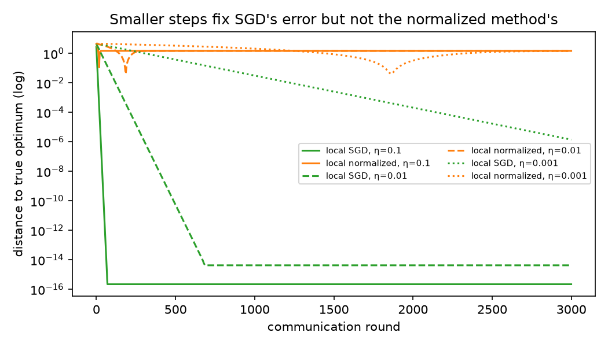

# Showcase: FedMuon, Part 1 of 4

> Prompt: *"explain me fedmuon"*. Produced with the `eureka` skill in Claude Code. Figures were generated and checked during the lesson by [`fedmuon-part1-figures.py`](fedmuon-part1-figures.py).

---

Part 1 of a 4-part lesson on FedMuon. Two different 2025 preprints carry that name: Takezawa, Koloskova, Jiang & Stich (arXiv 2509.26337) and Liu et al. (arXiv 2510.27403). Both exist to fix the same failure, and that failure is the subject of this part. Here is the plan:

- **Part 1 (this one): the problem.** Federated averaging, normalized ("LMO") steps, and why combining them breaks. You can understand the whole failure with vectors, before any matrix machinery.
- **Part 2: the fix.** Control variates (the SCAFFOLD idea, built from scratch), and how FedMuon puts them in exactly the right place: *inside* the normalization.
- **Part 3: the matrix case.** Muon itself: the SVD, the polar factor, why it's steepest descent under the spectral norm, Newton–Schulz, and why FedMuon still works when Newton–Schulz is only approximate.
- **Part 4: the evidence.** The convergence theorem and its assumptions, the experiments, the second FedMuon paper, and an honest critique.

I'm assuming you know SGD, momentum, gradients and basic linear algebra, but not federated learning or Muon. Tell me if you want any of that adjusted.

### The setting: training without moving the data

There are n clients (hospitals, phones, companies), and client i holds a dataset that never leaves it. We want one model, with parameters x, that is good on everyone's data. Write fᵢ(x) for the average loss of x on client i's data. The objective is

```
f(x) = (1/n) · Σᵢ fᵢ(x)        average of the client losses; i = 1..n
```

Its minimizer x* is the model we're after. Nobody can evaluate f directly, because that would need all the data in one place. Each client can only evaluate its own fᵢ and its gradient ∇fᵢ.

The cost model drives everything. Computing gradients on a client is cheap. **Communication** is expensive: sending a model with millions of parameters to and from many devices over slow links. A training algorithm is therefore judged by how many *rounds* of communication it needs.

The standard algorithm is **FedAvg** (local SGD). One round looks like this:

```
server sends xʳ to every client                           r = round index
each client:  xᵢ ← xʳ, then K times:  xᵢ ← xᵢ − η·∇fᵢ(xᵢ)   K local steps, step size η
server:       xʳ⁺¹ = (1/n) · Σᵢ xᵢ                         average the returned models
```

Each round buys K steps of computation for one round of communication.

Before anything goes wrong, notice why this is reasonable at all. Take the simplest case, K = 1:

```
xʳ⁺¹ = (1/n) Σᵢ ( xʳ − η·∇fᵢ(xʳ) )         each client takes one step from the same xʳ
     = xʳ − η · (1/n) Σᵢ ∇fᵢ(xʳ)            the n copies of xʳ average to xʳ; pull η out of the sum
     = xʳ − η · ∇f(xʳ)                       gradient of an average = average of gradients (linearity)
```

With one local step, FedAvg is *exactly* gradient descent on the global objective. The algebra worked because each client's step is a **linear** function of its gradient: the average of the steps equals the step on the average gradient. Hold on to that. Everything in this lesson comes from what happens when a client's step is *not* a linear function of its gradient.

With K > 1 there is already a small crack. After its first local step, client i is no longer at xʳ, so later gradients are evaluated at different points on different clients. When client losses differ, this causes a bias called **client drift**. It's the problem SCAFFOLD solved, and we'll build it properly in Part 2. For now, note one property of drift: it shrinks as the step size η shrinks or as K approaches 1. We'll soon meet a bias that has neither escape.

### Normalized steps: the "LMO" family of optimizers

Muon belongs to a family of optimizers that choose the *direction* of a step and fix its *size*. The cleanest way to see the family is to ask a question about a single step.

Near the current point, the loss changes by approximately ⟨g, d⟩ when we move by d, where g is the gradient (first-order Taylor expansion). Plain gradient descent moves by −ηg, so steep regions get long steps and flat regions short ones. Another option is to fix the step length first, then pick the best direction:

```
d* = argmin ⟨g, d⟩   over all d with ‖d‖ ≤ 1      "the most decrease per unit of step"
```

This is called a **linear minimization oracle** (LMO): minimize a linear function over a norm ball. The update is x ← x + η·lmo(g), so its length is always η.

For the ordinary Euclidean norm, the answer comes from Cauchy–Schwarz:

```
⟨g, d⟩ ≥ −‖g‖·‖d‖           Cauchy–Schwarz: |⟨g,d⟩| ≤ ‖g‖‖d‖
       ≥ −‖g‖                because ‖d‖ ≤ 1
equality when d = −g/‖g‖    check: ⟨g, −g/‖g‖⟩ = −‖g‖²/‖g‖ = −‖g‖
```

So lmo(g) = −g/‖g‖: normalized gradient descent. In one dimension, g/|g| is just the sign of g, so lmo(g) = −sign(g), and the method is sign descent.

The norm you put on the ball decides the optimizer:

- Euclidean ball → normalized GD.
- Max-norm ball (a cube) → per-coordinate sign descent, which is what Adam approximates.
- For weight matrices, the **spectral norm** ball → Muon. Its LMO is −UVᵀ from the SVD of the momentum: keep the singular *directions* of the update and set every singular *value* to 1. That's Part 3.

Every member of the family shares the property that matters here: **lmo is not linear.** Doubling g doesn't change lmo(g) at all. And in general

```
(1/n) Σᵢ lmo(gᵢ)  ≠  lmo( (1/n) Σᵢ gᵢ )        averaging and normalizing don't commute
```

Why use such methods at all, if they throw away magnitude? Because magnitude is often misleading. A Muon step moves the network by a controlled amount in every important direction, instead of letting a few large gradient components dominate. Muon trains transformers in noticeably fewer steps than AdamW, and that's precisely why people want it inside FedAvg's local loop. Fewer local steps to reach good local progress should mean fewer rounds.

Now let's put a normalized optimizer into FedAvg and watch what happens.

### The collision, in one dimension

Take the smallest example that shows the failure: one shared scalar parameter x, three clients, each with a quadratic loss centred on its own preferred value cᵢ.

```
fᵢ(x) = ½ (x − cᵢ)²,   with  c₁ = 0,  c₂ = 1,  c₃ = 10
∇fᵢ(x) = x − cᵢ
```

Think of x as a shared calibration offset. Clients 1 and 2 have similar data, and client 3 serves a different population, so its preferred value is far away. These numbers are illustrative; the structure is what matters.

The global optimum is where the *averaged* gradient vanishes:

```
∇f(x) = (1/3) Σᵢ (x − cᵢ) = x − (c₁+c₂+c₃)/3     average of the gradients
∇f(x*) = 0   ⇒   x* = (0 + 1 + 10)/3 = 3.67       the MEAN of the cᵢ
```

That's what the true optimum should be: client 3 is far away, so it pulls hard.

Now run FedAvg with **normalized** local steps, starting with K = 1 to isolate the effect. Each client's step is −η·sign(x − cᵢ), and the server averages them:

```
xʳ⁺¹ = xʳ − η · (1/3) Σᵢ sign(xʳ − cᵢ)
```

Look at what the average of signs computes. Each client contributes exactly +1 or −1 regardless of how far away its optimum is. Client 3, which sits 9 units from x = 1, has exactly the same say as client 2, which sits 0 units away. The server is no longer averaging *forces*. It's counting **votes**.

Where do the votes balance? Call the point x̂:

```
for 1 < x < 10:   signs are (+1, +1, −1) → average +1/3 → x moves left
for 0 < x < 1:    signs are (+1, −1, −1) → average −1/3 → x moves right
⇒ x̂ = 1                                    the MEDIAN of the cᵢ
```

The method converges to the median, 1, not the mean, 3.67. That's a different point, and the gap has nothing to do with step size or round count. The lower panel of Figure 1 shows exactly this. The green line is the averaged SGD step, which crosses zero at the mean. The orange staircase is the averaged normalized step, which crosses zero at the median. Each vertical jump in the staircase is one client switching its vote as x passes its preferred value.



I ran the full algorithm (K = 5 local steps, three step sizes η = 0.1, 0.01, 0.001). Local SGD ends at 3.6667 every time; local normalized steps end at 1.0000 every time. Nothing about the global loss (the black curve in the top panel) is minimized at 1. The global loss there is f(1) = 13.5, against f(3.67) = 10.2 at the true optimum.

Here is the general principle, which is my framing of the paper's argument. **Normalizing each client's step before averaging turns a weighted average into a vote.** Gradient averaging finds the point where the clients' *forces* balance. Normalized averaging finds a point where their *directions* balance, and in one dimension that's the median.

The FedMuon paper (Takezawa et al., their Theorem 1) proves the failure with an even smaller example. It uses two clients with optima 0 and −a, local Muon in one dimension (which reduces to momentum sign descent), and a start at x = −a/4. The two clients always vote in opposite directions, so the averaged update is exactly zero and **the server never moves**. With two clients, the "median" is the entire interval between them, so every point between the two optima is a fixed point. Their start has a nonzero global gradient, and they prove it stays nonzero forever. Momentum doesn't rescue it. Each client's momentum is still a scalar fed into a sign.

### The same thing in two dimensions: the geometric median

One dimension might look like a special case of signs. So go up a dimension, with four clients whose optima are points in the plane: three close together, one outlier.

```
fᵢ(x) = ½ ‖x − cᵢ‖²,   c = (0,0), (1,0.2), (0.4,1), (6,5)
∇fᵢ(x) = x − cᵢ
normalized local step:   −(x − cᵢ)/‖x − cᵢ‖      a unit vector pointing from x toward cᵢ
```

The global optimum is again the mean of the cᵢ, at (1.85, 1.55). The normalized server update averages **unit vectors** pointing toward each client's optimum. It stops where those unit vectors sum to zero:

```
Σᵢ (x − cᵢ)/‖x − cᵢ‖ = 0
```

That equation has a name. The left side is the gradient of Σᵢ ‖x − cᵢ‖, the *sum of distances* (not squared distances) to the cᵢ. Setting it to zero defines the **geometric median**, the point minimizing total distance. It's the multi-dimensional analogue of the median, and it's famous precisely for being robust to outliers. Robustness is a fine property in a statistics problem. Here it's a bug, because we were asked to minimize the average squared loss, which *does* care about the outlier.



Figure 2 shows four starting points (black dots). From each, FedAvg with local SGD (green) runs straight to the true optimum (green star, the mean). FedAvg with local normalized steps (orange) curves away and settles at the geometric median (orange star, at (0.71, 0.59), computed with Weiszfeld's algorithm). The orange paths aren't wandering: they're precisely minimizing the wrong objective. The red outlier client is effectively outvoted.

### Why this isn't an ordinary bias

Federated learning already lives with one bias, client drift, so it's worth being precise about why this one is different.

Client drift in local SGD comes from *taking several local steps*. Set K = 1, or let η → 0, and FedAvg becomes exact gradient descent (we derived this above). The normalization bias is already present at K = 1, because it comes from the *shape of each individual step*, not from the steps accumulating. And shrinking η doesn't help, because the averaged normalized direction points at the median whatever the step length.

Figure 3 measures this on the 2-D example, plotting distance to the true optimum per round on a log scale, for three step sizes.



The green curves (local SGD) all go to zero, down to floating-point precision; smaller η is just slower. The orange curves (local normalized) all level off at the same distance, about 1.49, which is exactly the distance from the mean to the geometric median. The dip in the orange η = 0.001 curve isn't convergence. It's the trajectory passing by the true optimum on its way to the median.

In the paper's language, local Muon's error has a floor proportional to ζ⋆², a measure of how different the clients' gradients are at the optimum. Their Theorem 1 is a lower bound of order Ω(ζ⋆²) that no choice of step size, number of rounds, or number of clients removes. And the IID case is the special case where all clients' gradients agree in direction, so the votes are unanimous and there's no bias. That's why both FedMuon papers report local Muon doing well on homogeneous data and badly on heterogeneous data.

Let me be careful about what the toy shows and doesn't. Real client losses aren't isotropic quadratics, and real Muon normalizes a *matrix* (the momentum of each weight matrix), not a vector. The vector case is a faithful model of the *mechanism*: any LMO step discards magnitude, so averaging LMO steps averages directions instead of forces. It is not a model of how big the effect is in a real network. In the matrix case the vote happens per singular direction. A direction where one client has a huge component and another a small opposite one can cancel to zero, even though the global gradient there is large. Part 3 makes that precise with an example.

### What a fix has to achieve

We can now state precisely what FedMuon must do, which is the best way to understand any algorithm before seeing it. We want to keep three things:

1. **Normalized local steps**, so we keep Muon's benefits.
2. **Several local steps per round**, so we keep the communication savings.
3. **Convergence to the true optimum** under heterogeneous data, with no ζ⋆² floor.

The diagnosis tells us where the fix must act. The damage is done the moment each client feeds its *own* gradient (or momentum) into the LMO. If every client could instead feed in an estimate of the *global* gradient, then every client would compute nearly the same normalized direction. The average of nearly identical directions is just that direction, and the vote becomes unanimous. So we need two ingredients:

- a way for each client to cheaply estimate the global gradient during its local steps, without extra communication per step;
- applying the correction **before** the normalization, not after.

**Preview (not yet the explanation).** FedMuon gives each client a stored correction, Cᵢ, its own momentum from the previous round. The server keeps C, the average of those. Each local step then normalizes Mᵢ − Cᵢ + C instead of Mᵢ: "my current momentum, minus my usual bias, plus the consensus". That is the control-variate idea from SCAFFOLD, placed inside the LMO. Part 2 builds control variates from first principles, derives why that expression estimates the global momentum, and reruns the experiments above to show the median turning back into the mean.

### Try these before Part 2

1. **Predict, then check.** Five clients in 1-D have optima at 0, 1, 2, 3 and 100. Where does FedAvg with local SGD converge, and where does FedAvg with local sign steps converge? Now move the outlier from 100 to 1,000,000. Which answer changes?
2. **Spot the hidden assumption.** I claimed the IID case has no normalization bias because "all clients' gradients agree in direction". In 1-D, construct a case where all clients have the *same* optimum but different curvatures, fᵢ(x) = ½·aᵢ·(x − c)², and decide whether local sign steps are biased. What does your answer say about which kind of heterogeneity causes the problem: different optima, or different curvature?
3. **Toward the fix.** In the 1-D example with optima 0, 1, 10, suppose every client could magically use the *global* gradient x − 3.67 inside its sign, instead of its own x − cᵢ. Where would FedAvg converge? Then say what a client would need to know to approximate x − 3.67 using only quantities it saw in the previous round. That's control variates, the subject of Part 2.

---

Sources: [Takezawa et al., arXiv 2509.26337](https://arxiv.org/abs/2509.26337) · [Liu et al., arXiv 2510.27403](https://arxiv.org/abs/2510.27403)
