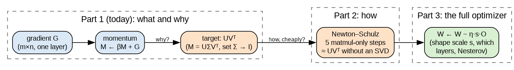
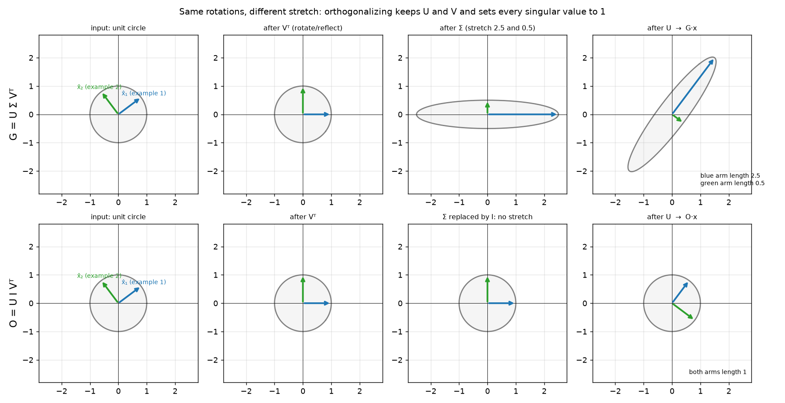
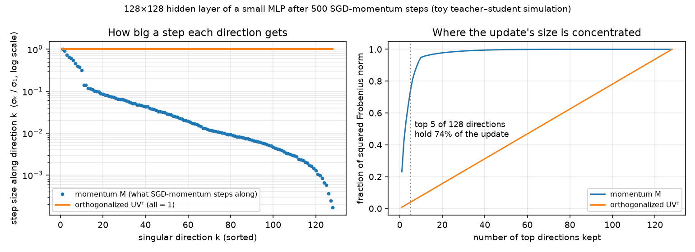

Muon is a short algorithm built on a long chain of ideas, and your question has two halves that each deserve full depth: *why* replace the update by its orthogonalized version, and *how* Newton–Schulz computes that version using nothing but matrix multiplications. Squeezing both into one answer would mean hand-waving one of them, so I'll split it into three parts:

- **Part 1 (this one): what "orthogonalizing the update" means and why it's the right thing to do.** Where a weight gradient's shape comes from, the SVD as rotate–stretch–rotate, what orthogonalizing does to it, why it's not Gram–Schmidt, and the derivation showing that UVᵀ is the steepest-descent direction when you measure step size the way a linear layer actually experiences it.
- **Part 2: Newton–Schulz.** How a matrix polynomial acts on singular values, the cubic iteration and why it converges, why the input has to be pre-scaled, and Muon's tuned quintic with its five steps.
- **Part 3: the full optimizer.** Nesterov momentum, the shape-dependent scale factor, which parameters get Muon and which stay on AdamW, a from-scratch implementation, and its limits.



That diagram is one Muon step for one weight matrix. Today is the left box: the jump from momentum M to the target UVᵀ, and the "why?" on that arrow.

I'm assuming you're comfortable with backprop, SGD with momentum, matrix multiplication and transposes, and that symmetric matrices have orthonormal eigenvectors (the spectral theorem). Tell me if any of those is shaky and I'll back up.

### The problem: a weight matrix is not a bag of numbers

Every optimizer you've probably used, from SGD to Adam, treats a weight matrix W ∈ ℝ^{m×n} as a list of mn independent numbers. SGD moves each entry in proportion to its partial derivative; Adam rescales each entry by its own running RMS. Neither one knows that those numbers are arranged into a matrix, and that the matrix *does* something: it's a linear map, taking an input activation x ∈ ℝⁿ to an output y = Wx ∈ ℝᵐ.

That's the gap Muon targets. If W is a map, then a change ΔW is a change to the map, and the question that matters is "how much does this change alter what the layer outputs?", not "how big are the entries?". Those two notions of size disagree, sometimes wildly, and the disagreement decides which update direction is best. Muon (introduced by Keller Jordan and collaborators in late 2024; the name is short for MomentUm Orthogonalized by Newton–Schulz) is what you get when you take the first notion seriously.

To see why it matters in practice, we first need to know what a weight gradient looks like as a matrix, because it turns out to have a very lopsided shape.

### Where a weight gradient's shape comes from

Take one linear layer, y = Wx, inside a network with scalar loss L. Backprop delivers δ = ∂L/∂y ∈ ℝᵐ, the sensitivity of the loss to each output coordinate. We want G = ∂L/∂W, an m×n matrix. Work entry by entry: output i is yᵢ = Σⱼ Wᵢⱼ xⱼ, and Wᵢⱼ appears only in yᵢ, so

```
∂L/∂Wᵢⱼ = (∂L/∂yᵢ) · (∂yᵢ/∂Wᵢⱼ)       chain rule; Wᵢⱼ affects L only through yᵢ
        = δᵢ · xⱼ                       ∂(Σₖ Wᵢₖ xₖ)/∂Wᵢⱼ = xⱼ
G       = δ xᵀ                          entry (i,j) of the outer product δxᵀ is δᵢxⱼ
          (m×1)(1×n) → m×n              shapes check out
```

So for a single example the gradient is an *outer product*: a rank-1 matrix whose input side is x (what came in) and whose output side is δ (how the loss wants the output to change). Read it as a map: G sends any input z to δ·(xᵀz), so it only "sees" the component of z along x, and only ever produces outputs along δ.

Over a batch of B examples the loss is a sum, so the gradient is a sum of these outer products:

```
G = Σ_b δ_b x_bᵀ                        one input-direction → output-direction pair per example
```

Here's a hand-sized case we'll carry through the whole lesson. A layer with 2 inputs and 2 outputs sees two examples. I've chosen the inputs to be unit length and perpendicular, and the error vectors to be perpendicular, only so that we can read the structure off by eye; real batches aren't so tidy, and the tool we're about to meet is exactly what untangles the untidy case. Example 1 is badly predicted (big error), example 2 is nearly right (small error):

```
x₁ = (0.8, 0.6)     δ₁ = (1.5, 2.0)    |δ₁| = 2.5
x₂ = (−0.6, 0.8)    δ₂ = (0.4, −0.3)   |δ₂| = 0.5

G = δ₁x₁ᵀ + δ₂x₂ᵀ = [1.20 0.90]  +  [−0.24  0.32]  =  [0.96 1.22]
                    [1.60 1.20]     [ 0.18 −0.24]     [1.78 0.96]
```

Notice how the plain gradient step W − ηG treats these two examples. Feed it example 1's input: G x₁ = δ₁(x₁ᵀx₁) + δ₂(x₂ᵀx₁) = δ₁, a correction of length 2.5. Feed it example 2's input: G x₂ = δ₂, a correction of length 0.5. The update is five times stronger along example 1's direction than example 2's. That's not obviously wrong (example 1 *is* worse), but hold on to the question it raises: is a direction with a small gradient unimportant, or merely quiet? We'll get a precise answer later.

In a real layer the x_b's aren't perpendicular, so G is a tangle of overlapping outer products. To ask "how strong is the update along each direction?" in general, we need a way to rewrite any matrix as a sum of *perpendicular* input→output pairs with strengths. That rewriting is the SVD.

### The SVD: every matrix is rotate, stretch, rotate

Ask a geometric question first. Take every unit-length input z (the unit circle in 2D, the unit sphere in general) and push it through G. A linear map sends a circle to an ellipse. The ellipse has a longest axis and a shortest axis, perpendicular to each other, and some input directions land exactly on those axes. Those special inputs, and the axes they land on, are the SVD.

Look at the top row of this figure, which does it for our G:



Read the top row left to right. The unit circle carries our two input directions (blue x₁, green x₂). The first step, Vᵀ, is a rotation (or reflection) that lines those special input directions up with the coordinate axes, and the circle stays a circle. The second step, Σ, stretches the horizontal axis by 2.5 and the vertical by 0.5, and that is the only step that changes any lengths; it turns the circle into the thin ellipse. The third step, U, rotates the ellipse into its final orientation in output space. The far-right panel is exactly G applied to the circle: the blue arm is G x₁ = δ₁, length 2.5, and the green arm is G x₂ = δ₂, length 0.5.

Formally, any real m×n matrix G of rank r can be written

```
G = U Σ Vᵀ = Σᵢ σᵢ uᵢ vᵢᵀ         (sum over i = 1..r)

V ∈ ℝ^{n×r}  columns vᵢ: orthonormal input directions   (right singular vectors)
Σ ∈ ℝ^{r×r}  diagonal, σ₁ ≥ σ₂ ≥ … ≥ σᵣ > 0: stretch factors (singular values)
U ∈ ℝ^{m×r}  columns uᵢ: orthonormal output directions  (left singular vectors)
```

This is the "reduced" SVD, keeping only the r directions with nonzero stretch. Read the sum form as a sentence: G is a sum of r rank-1 maps, each taking input direction vᵢ to output direction uᵢ with strength σᵢ, and the vᵢ are mutually perpendicular, and so are the uᵢ. It's the same kind of sum as Σ_b δ_b x_bᵀ, except the pieces don't overlap. We need *two* sets of directions, unlike an eigendecomposition, because inputs live in ℝⁿ and outputs in ℝᵐ; for a non-square W these are different spaces, and even for a square one there's no reason the best input axes and output axes coincide.

Why must such a decomposition exist? Here's the derivation, short enough to carry in your head:

```
GᵀG is n×n and symmetric                       (GᵀG)ᵀ = GᵀG
zᵀGᵀGz = |Gz|² ≥ 0                             so it is positive semidefinite
GᵀG = Σᵢ λᵢ vᵢvᵢᵀ, vᵢ orthonormal, λᵢ ≥ 0       spectral theorem
σᵢ := √λᵢ,   uᵢ := G vᵢ / σᵢ   (for σᵢ > 0)    define output directions as where vᵢ lands, normalised
uᵢᵀuⱼ = vᵢᵀGᵀG vⱼ /(σᵢσⱼ) = σⱼ² vᵢᵀvⱼ/(σᵢσⱼ)  GᵀG vⱼ = σⱼ² vⱼ
      = 1 if i = j, else 0                     vᵢ orthonormal → the uᵢ are orthonormal too
G = G Σᵢ vᵢvᵢᵀ = Σᵢ (G vᵢ) vᵢᵀ = Σᵢ σᵢ uᵢvᵢᵀ  Σᵢ vᵢvᵢᵀ is the identity on G's row space
```

The key line is the fifth: the images of perpendicular input directions are themselves perpendicular, which is what makes vᵢ "special". For our example you can check it by eye: v₁ = x₁, v₂ = x₂ (perpendicular, unit), G v₁ = δ₁ with length 2.5, G v₂ = δ₂ with length 0.5, so σ = (2.5, 0.5), u₁ = δ₁/2.5 = (0.6, 0.8), u₂ = δ₂/0.5 = (0.8, −0.6). `np.linalg.svd(G)` returns exactly these, up to the sign flips the SVD is always free to make (flip both uᵢ and vᵢ and the product is unchanged).

This hands us the language for the update. Along the pair (vᵢ, uᵢ), the step W − ηG changes the layer's response to input vᵢ by −ησᵢuᵢ. **The step size in direction i is proportional to σᵢ.** So the whole question "is the update lopsided?" becomes "how spread out are the singular values?"

### How lopsided real updates are

In our toy example the ratio is 5:1. In real networks it's far more extreme. I ran a small simulation to show you rather than tell you: a 3-layer tanh MLP (64 → 128 → 128 → 10) trained by SGD with momentum 0.9 on a teacher–student regression task (Gaussian inputs, targets produced by a random fixed network), batch 256. This is a toy, not a transformer, and I'm showing it only as an illustration of the phenomenon. After 500 steps I took the momentum buffer M of the 128×128 hidden layer and computed its singular values:



In the left panel (log scale), each blue dot is σₖ/σ₁, the relative step size SGD-momentum takes along its k-th direction. They fall by almost four orders of magnitude across 128 directions. The right panel says the same thing as a cumulative share: the top 5 of 128 directions hold 74% of the update's squared size. The orange lines are the orthogonalized update UVᵀ, which takes an equal step in every direction. That flat orange line is what Muon does, and the rest of this part is about why it's a better use of the step.

Jordan's write-up motivating Muon makes the corresponding claim for real models: that the momentum and Adam updates of transformer weight matrices typically have very high condition number (they're "almost low-rank"), and that orthogonalizing them increases the scale of rare directions that are small in the update but still matter for learning. Treat that as the author's empirical observation; the argument I'll derive below explains why amplifying those directions is principled rather than a hack.

### Orthogonal matrices, and what "orthogonalizing" G means

An orthogonal matrix Q (square, n×n) is one whose columns are orthonormal: QᵀQ = I. Three things follow, each in one line. It preserves lengths: |Qz|² = zᵀQᵀQz = zᵀz. It's trivially inverted: Q⁻¹ = Qᵀ. And all its singular values equal 1, because the SVD's stretch step is what changes lengths and Q changes none. Geometrically it's a rotation or a reflection, a rigid motion. For a rectangular m×n matrix with m ≥ n the analogue is *semi-orthogonal*: QᵀQ = Iₙ, columns orthonormal, still all singular values 1. (If m < n, the rows are orthonormal instead.)

Now the operation itself. Orthogonalizing G means: keep its rotations, throw away its stretch.

```
G = U Σ Vᵀ   ⟶   O = U Vᵀ          (Σ replaced by the identity)
```

That's the bottom row of the figure above. The same Vᵀ, the same U, but the middle panel no longer stretches anything, so the circle comes out a circle. O still sends each input direction vᵢ to the same output direction uᵢ as G did, but now with strength exactly 1 for every i. Neither the directions nor the input–output pairing change; only the per-direction strengths become equal.

For our example:

```
O = u₁v₁ᵀ + u₂v₂ᵀ = (0.6,0.8)ᵀ(0.8,0.6) + (0.8,−0.6)ᵀ(−0.6,0.8)
  = [0.48 0.36]  +  [−0.48  0.64]  =  [0 1]
    [0.64 0.48]     [ 0.36 −0.48]     [1 0]
```

A reflection that swaps the two coordinates. Check it: O x₁ = (0.6, 0.8) = u₁ and O x₂ = (0.8, −0.6) = u₂. Example 2's correction now has length 1, the same as example 1's. The update that once heavily favoured the badly predicted example now corrects both examples at the same rate, each in the direction its own error asks for.

The factorization has a name worth knowing. Write G = (UVᵀ)(VΣVᵀ): an orthogonal factor times a symmetric positive semidefinite "stretch" factor. That's the **polar decomposition**, the matrix analogue of writing a complex number as e^{iθ}·r, and UVᵀ is its *polar factor*. When people say Muon orthogonalizes the update, they mean it replaces M by the polar factor of M.

### Why not just Gram–Schmidt?

If you've met "orthogonalization" before, it was probably Gram–Schmidt, or QR, which is Gram–Schmidt recorded as a factorization G = QR. It's natural to ask whether Q would do the same job. It wouldn't, and the reason clarifies what UVᵀ is.

Gram–Schmidt processes columns in order. It keeps column 1's direction exactly, makes column 2 perpendicular to column 1, and so on. So Q depends on the arbitrary order of G's columns (which input neuron happens to be indexed first), and column 1 is treated as sacred while later columns get bent to fit around it. For our G, QR gives

```
Q = [0.475  0.880]          (first column = G's first column, normalised)
    [0.880 −0.475]
```

which is a different orthogonal matrix from O = [[0,1],[1,0]]. Reorder G's two columns, run QR, and reorder back, and you get yet another one, [[−0.618, 0.786], [0.786, 0.618]]. Three "orthogonalizations", three answers.

The polar factor doesn't have this problem because it has a characterization that refers to no ordering at all: **UVᵀ is the orthogonal matrix nearest to G** in Frobenius distance. I'll prove that in a moment, because it falls out of the same inequality as the main result. Numerically, |G − O|_F = 1.581 while |G − Q|_F = 1.794. Gram–Schmidt gives *an* orthonormal basis of G's column space; the polar factor gives the orthogonal matrix that most resembles G.

### Measuring the size of an update: the spectral norm

Now the real question. We get to pick a step ΔW. We want it to reduce the loss as much as possible, but it must be small, because the gradient is only a local, first-order description and a large step lands somewhere the description no longer holds. "Small" needs a norm, and here the choice of norm *is* the choice of optimizer.

The entry-wise way of measuring a matrix is the Frobenius norm, |ΔW|_F = √(Σᵢⱼ ΔWᵢⱼ²), which is just the Euclidean length of W flattened into a vector. But as we said at the start, what we actually care about is how much the change alters the layer's output. For an input x, the output changes by ΔW x. The worst case over all unit-length inputs is the **spectral norm**:

```
|ΔW|₂ := max over |x| = 1 of |ΔW x|
```

What is it in terms of the SVD? Let ΔW = UΣVᵀ (with the full set of V's columns, so Vᵀ is orthogonal) and z = Vᵀx:

```
|ΔW x|² = |U Σ Vᵀx|²                definition of the SVD
        = |Σ z|²                     U has orthonormal columns: preserves length
        = Σᵢ σᵢ² zᵢ²                 Σ is diagonal
        ≤ σ₁² Σᵢ zᵢ² = σ₁²           σ₁ is the largest; |z| = |x| = 1 since Vᵀ is orthogonal
```

with equality at x = v₁. So |ΔW|₂ = σ₁, the longest axis of the ellipse. And since any input scales linearly, the guarantee is

```
|ΔW x| ≤ |ΔW|₂ · |x|     for every input x
```

That is a statement directly about the layer's behaviour: bound the spectral norm of the update and you've bounded how much any activation passing through the layer can be pushed, whatever the input happens to be. The Frobenius norm gives the same kind of bound (σ₁ ≤ |ΔW|_F always), but loosely: it charges you for stretch in every direction even though any single input only feels the stretch along its own direction. For our G, |G|₂ = 2.5 and |G|_F = √(2.5² + 0.5²) = 2.55. In a 128×128 layer with a flat spectrum, the gap is a factor of √128 ≈ 11.

### Steepest descent depends on the norm

Here is the general recipe. Near the current W, the loss is approximately linear in the step:

```
L(W + ΔW) ≈ L(W) + ⟨G, ΔW⟩,      ⟨A, B⟩ := Σᵢⱼ AᵢⱼBᵢⱼ = tr(AᵀB)
```

where ⟨·,·⟩ is the matrix inner product (the dot product of the flattened matrices; the trace form is the same sum written so that we can use matrix algebra on it). The steepest-descent step under a norm |·| is

```
ΔW* = argmin ⟨G, ΔW⟩   subject to   |ΔW| ≤ η
```

the step within a "ball" of radius η that decreases the linearised loss the most. Change the norm and you change the ball's shape, so you change which point of the ball is lowest.

Two familiar cases show the effect before we do the matrix one. Treat the gradient as a vector g. With the Euclidean norm the ball is round, and Cauchy–Schwarz (⟨g, d⟩ ≥ −|g||d|, equality when d points opposite g) gives d* = −η g/|g|: plain normalised gradient descent. With the max-norm |d|_∞ = maxₖ|dₖ| the ball is a cube, each coordinate can independently go to ±η, and the best choice is d*ₖ = −η·sign(gₖ): sign descent. That second one should ring a bell: with its averaging turned off (β₁ = β₂ = 0), Adam's update m/√v is g/|g| entry-wise, which is exactly sign(g). With averaging on, Adam behaves like a smoothed version of steepest descent in the max-norm (this is the reading Bernstein and Newhouse give in their 2024 note "Old Optimizer, New Norm", which also frames Muon-style updates in this way). So SGD and Adam already differ by their choice of norm, both of which treat the matrix as a flat list of numbers. Muon's move is to use the norm that respects the matrix as a map.

### The derivation: steepest descent under the spectral norm gives UVᵀ

Write G = UΣVᵀ (reduced SVD, rank r) and let ΔW be any step with |ΔW|₂ ≤ η. First rewrite the decrease in terms of the singular directions:

```
⟨G, ΔW⟩ = tr(GᵀΔW)                      definition of the matrix inner product
        = tr(V Σ Uᵀ ΔW)                  Gᵀ = (UΣVᵀ)ᵀ = VΣUᵀ
        = tr(Σ Uᵀ ΔW V)                  cyclic property: tr(ABC) = tr(BCA)
        = Σᵢ σᵢ (UᵀΔWV)ᵢᵢ                Σ is diagonal, so only diagonal entries of UᵀΔWV survive
        = Σᵢ σᵢ · uᵢᵀ ΔW vᵢ              entry (i,i) of UᵀΔWV is uᵢᵀ ΔW vᵢ
```

That last line is the heart of the matter, so read it slowly. The first-order change in loss is a sum over directions. Each term is σᵢ (how strongly the gradient cares about direction i) times uᵢᵀΔWvᵢ (how far the step moves the layer's response to vᵢ along uᵢ). Call the latter the step along direction i, sᵢ.

Now the constraint. Each sᵢ is bounded by the spectral norm:

```
|sᵢ| = |uᵢᵀ ΔW vᵢ| ≤ |uᵢ| · |ΔW vᵢ|      Cauchy–Schwarz
                    ≤ 1 · |ΔW|₂ · |vᵢ|    uᵢ is unit; definition of spectral norm
                    ≤ η                    vᵢ is unit; |ΔW|₂ ≤ η
```

so

```
⟨G, ΔW⟩ = Σᵢ σᵢ sᵢ ≥ −η Σᵢ σᵢ          each sᵢ ≥ −η, and each σᵢ > 0
```

Can we hit that floor? We need sᵢ = −η for every i at once, with |ΔW|₂ ≤ η. Try ΔW = −η UVᵀ:

```
sᵢ = uᵢᵀ(−η UVᵀ) vᵢ = −η (Uᵀuᵢ)ᵀ(Vᵀvᵢ) = −η eᵢᵀeᵢ = −η       ✓ every direction at full step
|−η UVᵀ|₂ = η                                                 ✓ all its singular values are η
```

So

```
ΔW* = −η · U Vᵀ,      decrease achieved: η · Σᵢ σᵢ
```

The orthogonalized gradient is precisely the steepest-descent direction under the spectral norm. When G has full rank this is the only optimum; if some singular values are zero, the step is free in those directions and UVᵀ simply puts nothing there. The quantity Σᵢσᵢ that appears is called the nuclear norm of G, |G|_*.

The same inequality gives the "nearest orthogonal matrix" claim promised earlier. For any semi-orthogonal O (columns orthonormal, n ≤ m), |G − O|_F² = |G|_F² − 2⟨G, O⟩ + |O|_F², and |O|_F² = n is the same for all of them. So the nearest O is the one maximising ⟨G, O⟩; every such O has |O|₂ = 1, so the bound above (with η = 1 and the sign flipped) says ⟨G, O⟩ ≤ Σσᵢ, achieved by UVᵀ.

### Why the quiet directions deserve a full step

Now we can answer the question from the start: is a direction with a small σᵢ unimportant, or merely quiet? Compare how the two norms ration the step.

Under the Frobenius norm, the same calculation (Cauchy–Schwarz on the flattened matrices) gives ΔW = −η G/|G|_F, and the step along direction i is sᵢ = −η σᵢ/|G|_F. The budget is |ΔW|_F² = Σᵢ sᵢ² ≤ η². The directions *compete* for a shared budget of squared step size, and the optimal allocation is proportional to σᵢ: the loud directions take most of it, and a direction with σᵢ a thousand times smaller gets a step a thousand times smaller.

Under the spectral norm the budget is maxᵢ |sᵢ| ≤ η. A step along direction 37 doesn't use up any of direction 1's allowance, because the worst-case output change is set by the single largest step, not by the sum. So every direction that decreases the loss at all should be pushed to the limit, however small its σᵢ. That's the whole reason for the flat orange line: not that small directions are secretly as important as large ones (their contribution σᵢ·η to the decrease is still smaller), but that, measured by what the layer's outputs feel, taking them costs nothing extra.

Let's check that with numbers. Give both methods the same worst-case output change, |ΔW|₂ = η. For plain SGD that means scaling G by η/σ₁:

```
                          step along dir 1   step along dir 2   first-order decrease
SGD, scaled: −η G/σ₁       η                  0.2η               η(σ₁² + σ₂²)/σ₁ = 2.6η
Muon:        −η UVᵀ        η                  1.0η               η(σ₁ + σ₂)     = 3.0η
```

Same guaranteed bound on how much any output moves, 15% more first-order decrease, and example 2's error now gets corrected five times faster. In the 128×128 simulated layer, where the spectrum is far more spread out, the same ratio |M|_* / (|M|_F²/σ₁) comes to 2.16: for the same worst-case output change, the orthogonalized step buys more than twice the first-order decrease.

Notice what this example generalises to. The plain step's preference for direction 1 came from σ₁ = 2.5 versus σ₂ = 0.5, and in a real layer from σ₁ versus the σ's four orders of magnitude below it. Orthogonalizing doesn't decide which directions matter; it decides that magnitude differences between directions should not translate into step-size differences, because the geometry of the layer doesn't charge for them.

### Where the argument stops

The argument has assumptions, and each one is a real limit.

It's first order. The derivation optimises a linear model of the loss inside a ball, so the learning rate still matters: too large a ball and the linear model is wrong. Muon is not a second-order method and doesn't know about curvature.

It trusts the small directions. A direction with σ₁₂₈ = 10⁻⁴σ₁ in a single minibatch gradient might be signal or might be noise, and orthogonalization amplifies it either way. This is one reason Muon orthogonalizes the *momentum* buffer M rather than the raw gradient G: averaging over steps suppresses directions that don't persist. Whether that's enough is ultimately an empirical question, and the evidence for Muon is empirical (it set training-speed records on the NanoGPT speedrun, and has since been used for larger LLM training runs); Part 3 will be more specific about what's been reported.

It's about the update, not the weights. A common misreading is that Muon keeps W orthogonal. It doesn't; W accumulates many orthogonal steps, and their sum is not orthogonal.

It only makes sense for matrices that act as linear maps on activations. An embedding table is indexed, not multiplied (one-hot inputs), and biases and norm gains are vectors, so the spectral-norm argument doesn't apply to them; in practice they're left to AdamW. That's also Part 3.

And it costs an SVD. Computing UVᵀ exactly for every weight matrix at every step means an SVD per layer per step, which is expensive and runs poorly on GPUs. That's the problem Newton–Schulz solves, and it's where we pick up next.

### Before Part 2

Try these; the third sets up Part 2 directly.

1. Compute the orthogonalized update for G = [[3, 0], [0, 0.003]] and for G = [[3, 0], [0, 0]]. Then explain why a tiny change in G (0.003 → 0) produces a big change in UVᵀ. What does that say about how sensitive orthogonalization is to near-zero singular values, and why might an *approximate* method that only roughly equalises them be acceptable?
2. Show that if a batch has only one example, so G = δxᵀ, the Muon step points in the same direction as SGD. Then say in one sentence why Muon can only differ from SGD when the update has rank at least 2.
3. Take G = UΣVᵀ and compute G Gᵀ G in terms of U, Σ, V. What does the map G ↦ GGᵀG do to each singular value? And what would the map G ↦ 1.5·G − 0.5·GGᵀG do to a singular value of 0.5? Of 1? Of 1.2?

If question 3 makes you suspect that you can push every σᵢ toward 1 using only matrix multiplications, and never computing U, Σ or V, you've invented the core of Newton–Schulz. Say when you want Part 2 and we'll make that precise: why it converges, why G must first be divided by its norm, and why Muon uses a stranger-looking quintic with coefficients (3.4445, −4.7750, 2.0315).

A Manim version of the rotate–stretch–rotate figure (animating G and O stage by stage) is at `round3-muon-visuals/orthogonalize_scene.py`. I haven't rendered it, because Manim isn't installed here; with Manim installed, run `manim -pql orthogonalize_scene.py GvsO` and `manim -pql orthogonalize_scene.py OrthogonalizedO`.
